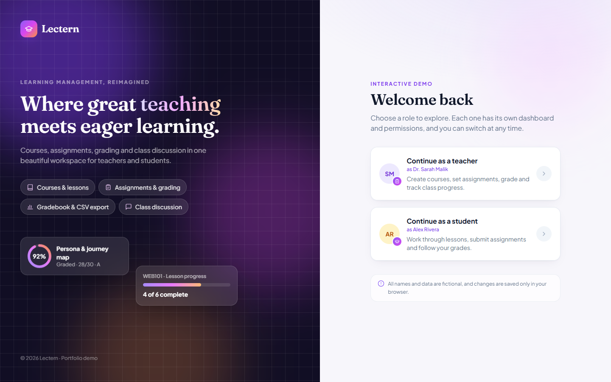
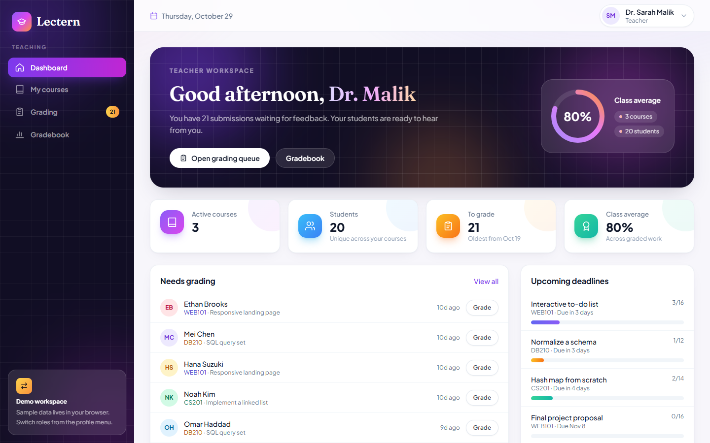
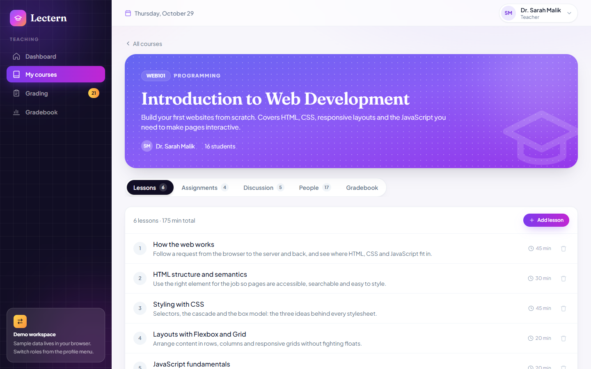

# Lectern: Learning Management System

A learning platform for teachers and students with courses, lessons, assignments, grading, a gradebook and class discussion. Built with React, TypeScript and Tailwind CSS.

**Live demo:** _add your Vercel URL here_





## Two roles, two experiences

Sign in as either role from the landing page and switch at any time from the profile menu.

**Teacher**
- **Dashboard:** KPIs (courses, students, work to grade, class average), a grading queue, upcoming deadlines with submission rates, and per-course grade and completion stats
- **Courses:** create courses, add or remove lessons, publish assignments with due dates and points
- **Grading:** filter submissions by course, assignment and status; late flags; score with live percentage and letter grade; quick-feedback chips
- **Gradebook:** students × assignments grid with graded, pending and missing states, averages, lesson progress and CSV export
- **People and discussion:** class roster with progress, announcements and a Q&A thread

**Student**
- **Dashboard:** due this week, overall average, "continue learning" cards that jump to the next lesson, and recent grades with feedback
- **Lessons:** a reader with key points, a course outline sidebar and "complete & continue" progress tracking
- **Assignments:** To do, Missing, Submitted and Graded filters; submit, resubmit and late submission; teacher feedback once graded
- **Grades:** per-course averages and letter grades with every assignment's score
- **Catalog:** browse and enroll in more courses



## Details

- Role-based routing: students can only open courses they're enrolled in, and teachers only courses they teach
- Sample data (2 teachers, 20 students, 5 courses, 30 lessons, 20 assignments and around 250 submissions) is generated deterministically. Dates are shifted forward on load, so the demo never looks stale
- State persists in localStorage. **Reset demo data** in the profile menu restores the original data
- Responsive down to phone width, with a drawer sidebar and horizontally scrolling tables
- No UI or icon libraries; every component is hand-built

## Tech stack

React 18 · TypeScript · Vite · Tailwind CSS · React Router · Fraunces + Plus Jakarta Sans

## Run locally

```bash
npm install
npm run dev
```

## Deploy

Import the repo on [Vercel](https://vercel.com). The defaults (Vite, `npm run build`, output `dist`) work as-is. `vercel.json` (and `public/_redirects` for Netlify) handle client-side routing.
